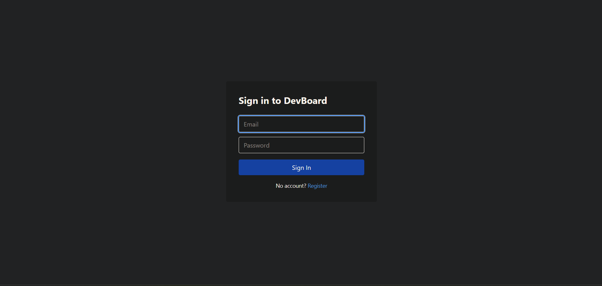
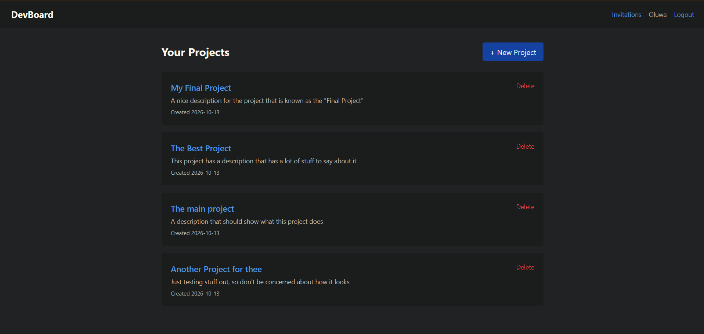
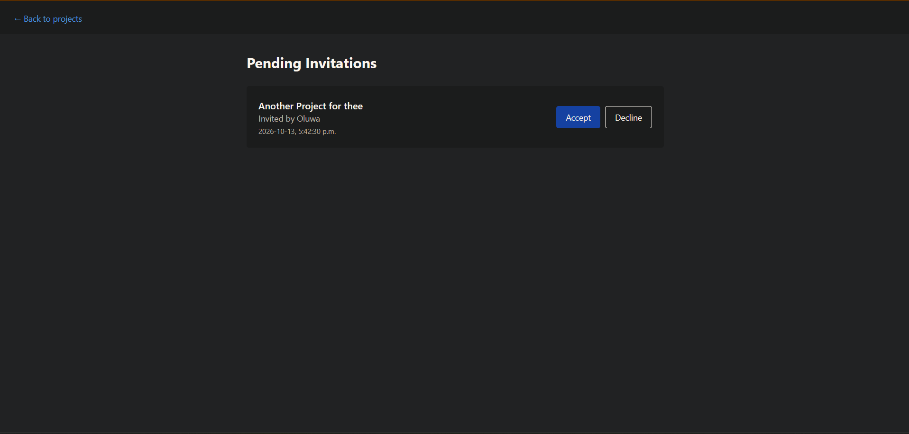

# DevBoard — Backend API

A full-stack project tracker. This is the backend: a Spring Boot REST API with JWT authentication, team collaboration, and task management.

**Live API:** https://devboard-6i7g.onrender.com  
**Frontend repo:** https://github.com/Bamijoko-Seyi/devboard-ui  
**Frontend demo:** https://devboard-ui.vercel.app

---

## Features

- **JWT authentication** — register, login, stateless sessions
- **Projects** — CRUD with ownership
- **Team members** — invite by email, accept/decline flow
- **Roles** — OWNER / EDITOR / VIEWER with permission enforcement
- **Tasks** — status (TODO / IN_PROGRESS / DONE), assignee, due date
- **Global error handling** — consistent JSON error responses

## Tech Stack

| Layer | Choice |
|---|---|
| Language | Java 21 |
| Framework | Spring Boot 4.1 |
| Security | Spring Security + JJWT |
| Persistence | Spring Data JPA + Hibernate |
| Database | PostgreSQL 16 (Neon in production) |
| Build | Maven |
| Container | Docker (multi-stage build) |
| Hosting | Render |
| Testing | JUnit 5, Mockito, MockMvc, H2 |

## Architecture

```
src/main/java/com/devboard/
├── config/         Security, CORS, JWT filter
├── controller/     REST endpoints
├── dto/            Request/response shapes (never expose entities)
├── entity/         JPA entities
├── repository/     Spring Data interfaces
└── service/        Business logic + permission checks
```

Request flow: `JwtAuthFilter` → `SecurityFilterChain` → `Controller` → `Service` → `Repository` → PostgreSQL.

## Running Locally

**Prerequisites:** Docker Desktop, Java 21, Maven (or use `./mvnw`).

### With Docker (recommended)

```bash
docker compose up --build
```

Backend live at http://localhost:8080.

### With a local Postgres + IDE

```bash
docker run --name devboard-db -e POSTGRES_PASSWORD=dev -e POSTGRES_DB=devboard -p 5432:5432 -d postgres:16
./mvnw spring-boot:run
```

## Environment Variables

| Variable | Description | Default |
|---|---|---|
| `SPRING_DATASOURCE_URL` | JDBC URL | `jdbc:postgresql://localhost:5432/devboard` |
| `SPRING_DATASOURCE_USERNAME` | DB user | `postgres` |
| `SPRING_DATASOURCE_PASSWORD` | DB password | `dev` |
| `JWT_SECRET` | Signing key (≥32 chars) | dev placeholder |
| `JWT_EXPIRATION_MS` | Token lifetime in ms | `86400000` |
| `SPRING_PROFILES_ACTIVE` | Active profile | none |

See `.env.example` for a template.

## API Endpoints

### Auth

| Method | Path | Description |
|---|---|---|
| POST | `/api/auth/register` | Create a new account |
| POST | `/api/auth/login` | Get a JWT |
| GET | `/api/auth/me` | Current user info (auth required) |

### Projects

| Method | Path | Description |
|---|---|---|
| GET | `/api/projects` | List projects the user is a member of |
| POST | `/api/projects` | Create a project |
| GET | `/api/projects/{id}` | Get a project |
| PUT | `/api/projects/{id}` | Update a project (editor+) |
| DELETE | `/api/projects/{id}` | Delete a project (owner only) |
| GET | `/api/projects/{id}/members` | List project members |

### Invitations

| Method | Path | Description |
|---|---|---|
| POST | `/api/projects/{id}/invitations` | Invite by email (owner only) |
| GET | `/api/projects/{id}/invitations` | List project invitations |
| GET | `/api/invitations/pending` | My pending invitations |
| POST | `/api/invitations/{id}/accept` | Accept invitation |
| POST | `/api/invitations/{id}/decline` | Decline invitation |

### Tasks

| Method | Path | Description |
|---|---|---|
| GET | `/api/projects/{id}/tasks` | List tasks |
| POST | `/api/projects/{id}/tasks` | Create a task (editor+) |
| PUT | `/api/projects/{id}/tasks/{taskId}` | Update a task (editor+) |
| DELETE | `/api/projects/{id}/tasks/{taskId}` | Delete a task (editor+) |

## Testing

```bash
./mvnw test
```

Coverage report: `target/site/jacoco/index.html`

## Known Limitations (Free Tier)

- **Cold starts:** the API sleeps after 15 min of inactivity on Render. First request takes 30–60 seconds.
- **Database suspend:** Neon's free tier suspends compute after 5 min idle. First query takes ~2 seconds.
- **No refresh tokens:** access tokens expire after 1 hour in production. Re-login required.

## What I'd Do With More Time

- Refresh tokens for a smoother session flow
- Flyway migrations instead of `ddl-auto`
- File attachments on tasks (S3 / Cloudinary)
- Email notifications for invitations
- Real-time updates via WebSockets
- Rate limiting on auth endpoints

## Screenshots
    
    
    
    
    


## License

MIT License

Copyright (c) 2026 Oluwaseyifunmi Bamijoko

Permission is hereby granted, free of charge, to any person obtaining a copy
of this software and associated documentation files (the "Software"), to deal
in the Software without restriction, including without limitation the rights
to use, copy, modify, merge, publish, distribute, sublicense, and/or sell
copies of the Software, and to permit persons to whom the Software is
furnished to do so, subject to the following conditions:

The above copyright notice and this permission notice shall be included in all
copies or substantial portions of the Software.

THE SOFTWARE IS PROVIDED "AS IS", WITHOUT WARRANTY OF ANY KIND, EXPRESS OR
IMPLIED, INCLUDING BUT NOT LIMITED TO THE WARRANTIES OF MERCHANTABILITY,
FITNESS FOR A PARTICULAR PURPOSE AND NONINFRINGEMENT. IN NO EVENT SHALL THE
AUTHORS OR COPYRIGHT HOLDERS BE LIABLE FOR ANY CLAIM, DAMAGES OR OTHER
LIABILITY, WHETHER IN AN ACTION OF CONTRACT, TORT OR OTHERWISE, ARISING FROM,
OUT OF OR IN CONNECTION WITH THE SOFTWARE OR THE USE OR OTHER DEALINGS IN THE
SOFTWARE.